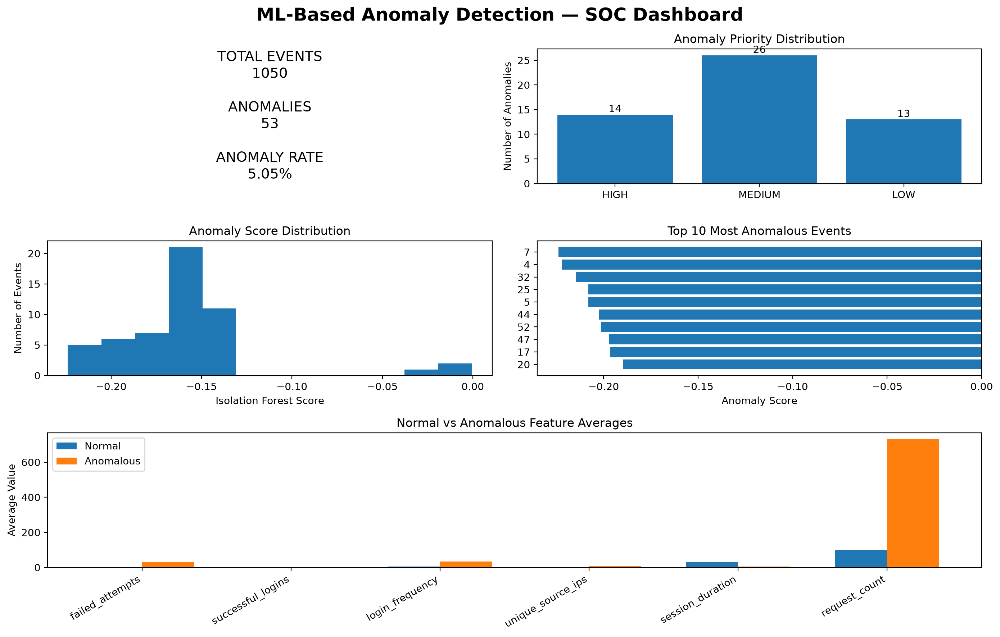

# 🧠 ML-Based Anomaly Detector

A machine learning-based cybersecurity project that uses **Python, Pandas, and Isolation Forest** to detect unusual security events, investigate anomalies, assign SOC priorities, and generate an automated investigation report.

This project is **Project 3** in my journey toward becoming an **AI SOC Analyst**.

---

## 🎯 Project Goal

Traditional SOC environments generate large volumes of security events, making it difficult for analysts to manually identify unusual behavior.

The goal of this project is to build a practical machine learning pipeline that can:

- Analyze security event data
- Engineer behavioral features
- Detect unusual activity using machine learning
- Calculate anomaly scores
- Investigate detected anomalies
- Explain suspicious behavior
- Assign investigation priorities
- Visualize results
- Generate an automated SOC investigation report
- Validate the system with automated tests

The project focuses on building a foundation for future **AI-assisted SOC detection and investigation systems**.

---

## 📊 Project Results

The completed pipeline analyzed **1,050 security events**.

| Metric | Result |
|---|---:|
| 🔎 Events Analyzed | **1,050** |
| ✅ Normal Events | **997** |
| 🚨 Anomalous Events | **53** |
| 📈 Anomaly Rate | **5.05%** |
| 🔴 HIGH Priority | **14** |
| 🟠 MEDIUM Priority | **26** |
| 🟢 LOW Priority | **13** |
| 🧪 Automated Tests | **8 passing** |

### SOC Anomaly Dashboard

The project generates a visual SOC dashboard showing anomaly statistics, priority distribution, anomaly scores, and feature behavior.



---

# 🏗️ Architecture

```text
                    SECURITY EVENT DATA
                           │
                           ▼
                 ┌─────────────────────┐
                 │  Data Exploration   │
                 │   & Validation      │
                 └──────────┬──────────┘
                            │
                            ▼
                 ┌─────────────────────┐
                 │ Feature Engineering │
                 └──────────┬──────────┘
                            │
                            ▼
                 ┌─────────────────────┐
                 │   Isolation Forest  │
                 │    Model Training   │
                 └──────────┬──────────┘
                            │
                            ▼
                 ┌─────────────────────┐
                 │ Anomaly Detection   │
                 └──────────┬──────────┘
                            │
                  ┌─────────┴─────────┐
                  ▼                   ▼
          Normal Events        Anomalous Events
                                      │
                                      ▼
                            ┌───────────────────┐
                            │ Anomaly           │
                            │ Investigation     │
                            └─────────┬─────────┘
                                      │
                                      ▼
                            ┌───────────────────┐
                            │ Priority          │
                            │ Classification    │
                            └─────────┬─────────┘
                                      │
                         ┌────────────┴────────────┐
                         ▼                         ▼
                  SOC Dashboard             SOC Report
```

---

# 🔍 Key Features

### 🧠 Machine Learning Detection

Uses **Isolation Forest** to identify unusual security events without requiring manually labeled attack data.

### 📊 Behavioral Feature Engineering

Transforms raw security events into behavioral features such as:

- Failed login attempts
- Successful logins
- Login frequency
- Unique source IPs
- Login hour
- Session duration
- Request count

### 🚨 Anomaly Scoring

Each event receives an anomaly score from the Isolation Forest model.

More unusual observations receive stronger anomaly signals.

### 🔎 Automated Investigation

Detected anomalies are compared against normal-event behavior to identify extreme or unusual feature values.

### 🎯 Investigation Prioritization

Anomalies are categorized into:

- **HIGH**
- **MEDIUM**
- **LOW**

Priority is determined from the distribution of anomaly scores among detected anomalies.

### 📈 SOC Dashboard

Generates a visual dashboard containing:

- Total events
- Anomaly count
- Anomaly rate
- Priority distribution
- Anomaly score distribution
- Top anomalous events
- Normal vs anomalous feature behavior

### 📄 Automated SOC Report

Generates a text-based investigation report containing:

- Executive summary
- Detection statistics
- Priority breakdown
- Top anomalies
- Anomaly scores
- Investigation reasons
- Relevant event information
- Recommended SOC actions

### 🧪 Automated Testing

Includes automated tests covering the core anomaly detection and investigation pipeline.

---

# 🛡️ Security Event Analysis

The project works with simulated security events containing behavioral information that can be used to identify suspicious activity.

Example features include:

```text
failed_attempts
successful_logins
login_frequency
unique_source_ips
login_hour
session_duration
request_count
```

These features represent different aspects of user and system behavior.

---

# ⚙️ Feature Engineering

Raw security event information is transformed into machine-learning features.

The current model uses:

| Feature | Purpose |
|---|---|
| `failed_attempts` | Detect excessive authentication failures |
| `successful_logins` | Identify unusual successful authentication activity |
| `login_frequency` | Identify unusually frequent login behavior |
| `unique_source_ips` | Identify access from many different sources |
| `login_hour` | Detect unusual login times |
| `session_duration` | Identify unusual session behavior |
| `request_count` | Detect unusually high activity |

This creates a behavioral representation of each security event.

---

# 🧠 Machine Learning — Isolation Forest

The project uses **Isolation Forest**, an unsupervised machine learning algorithm designed for anomaly detection.

The model is useful for SOC environments because anomaly detection does not always require a large collection of labeled attack examples.

The workflow is:

```text
Security Events
      │
      ▼
Feature Engineering
      │
      ▼
Isolation Forest
      │
      ▼
Prediction
      │
      ▼
Anomaly Score
```

The model classifies events as either:

```text
1   → Normal
-1  → Anomalous
```

---

# 🚨 Anomaly Detection

The detection stage analyzed:

```text
Events analyzed: 1050
Normal events detected: 997
Anomalous events detected: 53
```

This produced an anomaly rate of approximately:

```text
5.05%
```

The results are saved to:

```text
reports/anomaly_results.csv
```

---

# 🔎 Anomaly Investigation

After detection, the anomalous events are investigated against the normal-event baseline.

The investigation identifies unusually extreme feature values and generates human-readable explanations.

Example:

```text
Anomaly Score: -0.1971
Priority: HIGH

Reasons:
- Extreme failed attempts
- Extreme login frequency
- Extreme unique source IPs
- Extreme login hour
- Extreme session duration
- Extreme request count
```

Investigation results are saved to:

```text
reports/anomaly_investigation.csv
```

This moves the project beyond simply detecting anomalies and toward **SOC analyst-style investigation and explainability**.

---

# 🎯 Investigation Priority

The 53 detected anomalies were prioritized using the distribution of anomaly scores.

| Priority | Events |
|---|---:|
| 🔴 HIGH | 14 |
| 🟠 MEDIUM | 26 |
| 🟢 LOW | 13 |

The prioritization is data-driven rather than relying on an arbitrary fixed anomaly-score threshold.

---

# 📈 Anomaly Score Analysis

The detected anomaly scores were distributed as follows:

| Statistic | Score |
|---|---:|
| Minimum | -0.223948 |
| 25th Percentile | -0.177353 |
| Median | -0.158361 |
| 75th Percentile | -0.148492 |
| Maximum | -0.000468 |

The score distribution is used to separate detected anomalies into investigation priorities.

---

# 📊 SOC Dashboard

The project automatically generates:

```text
reports/anomaly_dashboard.png
```

The dashboard provides a quick SOC-style overview of the detection results, including:

- Event volume
- Anomaly count
- Anomaly percentage
- Priority distribution
- Anomaly score distribution
- Top anomalous events
- Feature comparison between normal and anomalous activity


---

# 📄 Automated SOC Investigation Report

The project generates:

```text
reports/anomaly_report.txt
```

The report contains:

### Executive Summary

A high-level overview of the detection results.

### Detection Statistics

Total events, normal events, anomalies, and anomaly rate.

### Priority Breakdown

Distribution of HIGH, MEDIUM, and LOW priority anomalies.

### Top Anomalies

The most significant anomalous events and their scores.

### Investigation Reasons

Explanations describing which behavioral features contributed to the suspicious classification.

### SOC Recommendations

Suggested analyst actions based on the investigation results.

---

# 🧪 Testing

The project includes an automated test suite covering the main detection and investigation components.

Tests include:

- Anomaly detection
- Anomaly score generation
- Baseline calculation
- Anomaly explanation
- Priority classification
- Report generation

Test result:

```text
........
----------------------------------------------------------------------
Ran 8 tests in 0.052s

OK
```

Run the tests with:

```bash
python -m unittest discover -s tests -v
```

---

# 📁 Project Structure

```text
ml-based-anomaly-detector/
│
├── data/
│   └── security_events.csv
│
├── reports/
│   ├── anomaly_dashboard.png
│   ├── anomaly_investigation.csv
│   ├── anomaly_report.txt
│   └── anomaly_results.csv
│
├── src/
│   ├── analyze_anomalies.py
│   ├── detect_anomalies.py
│   ├── explore_data.py
│   ├── feature_engineering.py
│   ├── generate_dataset.py
│   ├── generate_report.py
│   ├── train_model.py
│   └── visualize_anomalies.py
│
├── tests/
│   ├── __init__.py
│   └── test_anomaly_detector.py
│
├── .gitignore
├── README.md
└── requirements.txt
```

The trained Isolation Forest model is intentionally excluded from Git tracking and can be regenerated locally.

---

# 🚀 Installation

Clone the repository:

```bash
git clone https://github.com/jamese345/ml-based-anomaly-detector.git
```

Navigate into the project:

```bash
cd ml-based-anomaly-detector
```

Create a virtual environment:

```bash
python -m venv venv
```

Activate it on Windows:

```bash
venv\Scripts\activate
```

Install dependencies:

```bash
pip install -r requirements.txt
```

---

# ▶️ Usage

### 1. Generate Security Events

```bash
python src/generate_dataset.py
```

### 2. Explore the Dataset

```bash
python src/explore_data.py
```

### 3. Engineer Features

```bash
python src/feature_engineering.py
```

### 4. Train the Model

```bash
python src/train_model.py
```

### 5. Detect Anomalies

```bash
python src/detect_anomalies.py
```

### 6. Investigate Anomalies

```bash
python src/analyze_anomalies.py
```

### 7. Generate SOC Dashboard

```bash
python src/visualize_anomalies.py
```

### 8. Generate SOC Report

```bash
python src/generate_report.py
```

### 9. Run Tests

```bash
python -m unittest discover -s tests -v
```

---

# 🛠️ Technologies

- **Python**
- **Pandas**
- **NumPy**
- **Scikit-learn**
- **Joblib**
- **Matplotlib**
- **Unittest**
- **CSV**
- **Machine Learning**
- **Git & GitHub**

---

# 🔐 Security Concepts Demonstrated

This project demonstrates practical understanding of:

- Security event analysis
- Behavioral anomaly detection
- Unsupervised machine learning
- Feature engineering
- Baseline analysis
- SOC alert prioritization
- Detection explainability
- Security data visualization
- Automated investigation
- SOC reporting
- Python automation
- Automated testing

---

# ⚠️ Limitations

This is a portfolio and learning project using simulated security data.

Current limitations include:

- The dataset is synthetic
- The model is trained on the generated dataset
- Isolation Forest can produce false positives
- Anomaly detection does not automatically mean malicious activity
- Investigation explanations are feature-based rather than LLM-generated
- No live SIEM integration is currently implemented
- No real-time event streaming is currently implemented
- Threat intelligence enrichment is not yet included

These limitations provide opportunities for future development.

---

# 🔮 Future AI SOC Roadmap

This project is part of a larger AI SOC development roadmap.

### Project 1 — SOC Log Analyzer
**Python + Security Logs**

Built a rule-based security log analysis pipeline.

### Project 2 — Automated Alert Triage Engine
**Python + Detection + Risk Scoring**

Built an automated alert triage and prioritization system.

### Project 3 — ML-Based Anomaly Detector
**Python + Machine Learning**

Current project.

Introduces behavioral anomaly detection using Isolation Forest.

### Project 4 — Threat Intelligence Enrichment Engine
**APIs + Automation + OSINT**

Planned next.

### Project 5 — Cybersecurity RAG Assistant
**RAG + Embeddings + LLM**

Planned.

### Project 6 — AI SOC Investigation Agent
**LLM + Tools + RAG + Python**

Planned.

### Project 7 — Full AI SOC Analyst Platform
**Everything Combined**

The long-term goal is to combine detection, triage, machine learning, threat intelligence, RAG, LLMs, and automated investigation into a complete AI-assisted SOC platform.

---

# 📚 Learning Progression

This project represents the progression from rule-based cybersecurity automation toward machine learning-based security detection.

```text
Project 1
SOC Log Analyzer
      │
      ▼
Project 2
Automated Alert Triage
      │
      ▼
Project 3
ML-Based Anomaly Detection
      │
      ▼
Project 4
Threat Intelligence
      │
      ▼
Project 5
Cybersecurity RAG
      │
      ▼
Project 6
AI SOC Investigation Agent
      │
      ▼
Project 7
Full AI SOC Analyst Platform
```

---

# 💡 Why This Project Matters

A SOC analyst cannot manually investigate every event generated by a modern security environment.

Machine learning can help identify unusual behavior and reduce the amount of data analysts need to investigate manually.

This project demonstrates the ability to build a complete pipeline that moves from:

**Security Data → Machine Learning → Anomaly Detection → Investigation → Prioritization → Visualization → SOC Reporting**

The next stage is to combine this capability with **threat intelligence and AI-assisted investigation**.

---

# 👨‍💻 Author

**Brian Owala**

Cybersecurity Analyst focused on combining **Cybersecurity, Python, and AI**.

Currently building practical AI SOC projects to strengthen my skills and develop intelligent security solutions.

🎯 Long-term goal: **AI SOC Analyst**

---

# 📌 Project Status

**Status:** ✅ Completed

**Project:** 3 / 7

**Current Focus:** Machine Learning for Cybersecurity

**Detection Model:** Isolation Forest

**Tests:** 8 / 8 Passing

**Next Project:** 🔎 Threat Intelligence Enrichment Engine

---

## ⭐ If You Find This Project Useful

Feel free to explore the repository, review the implementation, and follow the journey as I continue building toward a complete **AI SOC Analyst platform**.